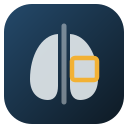
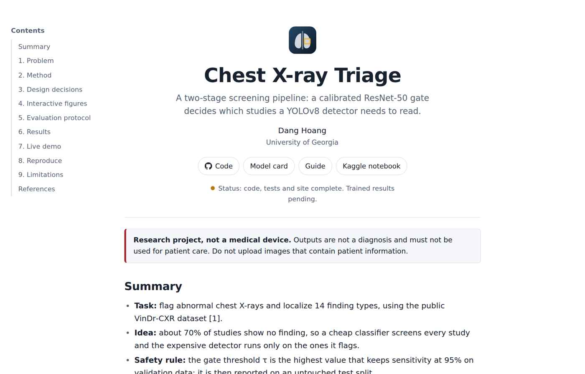
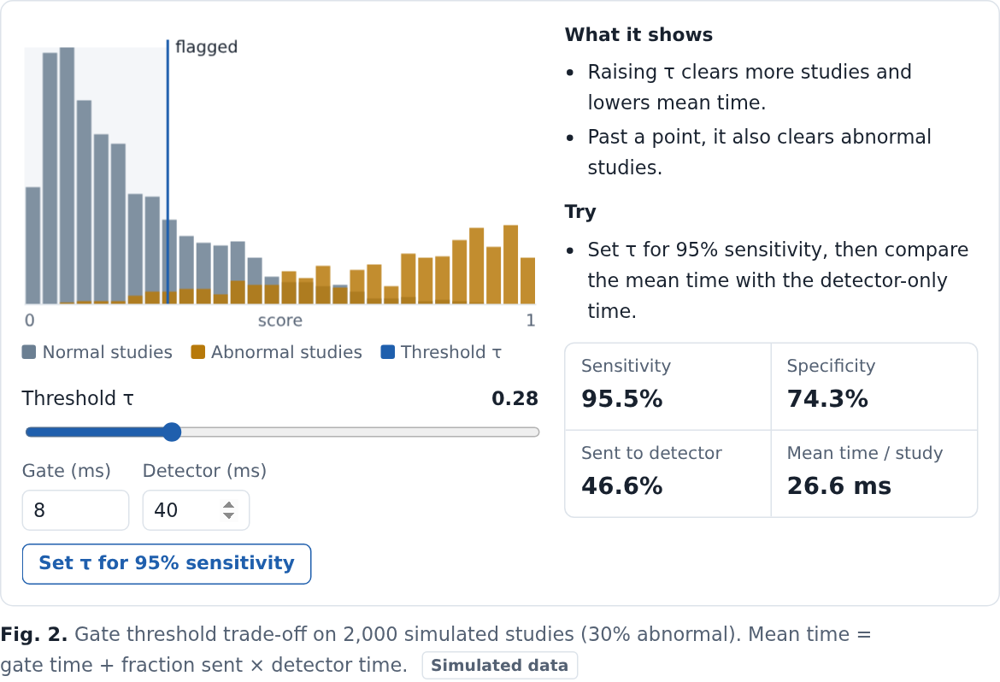
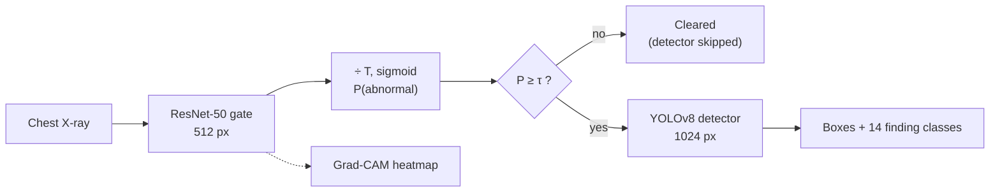

<p align="center">
  
</p>

<h1 align="center">Chest X-ray Triage</h1>

<p align="center">
  Two-stage chest X-ray screening: a calibrated ResNet-50 gate clears normal studies in milliseconds,<br>
  and YOLOv8 localizes findings only on the studies it flags.
</p>

<p align="center">
  <a href="https://danghoang2605-ds-ai.github.io/chest-xray-triage/"><b>Open the interactive site</b></a> •
  <a href="#run-locally">Run locally</a> •
  <a href="#architecture">Architecture</a> •
  <a href="docs/GUIDE.md">Guide</a> •
  <a href="docs/MODEL_CARD.md">Model card</a>
</p>

<p align="center">
  <a href="https://github.com/danghoang2605-ds-ai/chest-xray-triage/actions/workflows/tests.yml"></a>
  <a href="https://github.com/danghoang2605-ds-ai/chest-xray-triage/actions/workflows/deploy-pages.yml"></a>
  
  <a href="LICENSE"></a>
</p>

> **Not a medical device.** This is a research and portfolio project built on public data. Its outputs are not a diagnosis and must not be used for patient care. Do not upload images that contain patient information.

<p align="center">
  <a href="https://danghoang2605-ds-ai.github.io/chest-xray-triage/"></a>
</p>

---

## Try it in 30 seconds

1. Open **https://danghoang2605-ds-ai.github.io/chest-xray-triage/**. The page is laid out like a research project page: summary, method, design decisions, evaluation protocol, results, limitations and references.
2. In **Fig. 2 (gate threshold)**, drag τ or click **Set τ for 95% sensitivity**, and watch sensitivity, specificity, the share sent to the detector and the mean time per study.
3. In **Fig. 3 (box fusion)**, drag one radiologist's box until WBF stops merging it. In **Fig. 4 (calibration)**, change T and see probabilities move while the ranking stays the same.
4. With trained weights, start the API locally and use **7. Live demo** to get the gate score, boxes and a Grad-CAM heatmap for your own image.

The interactive figures use simulated data and are labeled as such. The **Results** table lists every metric that will be reported and shows *Pending* until `src/report.py` publishes a real run.

<p align="center">
  
</p>

## The problem

Most chest X-rays are normal: in VinDr-CXR about 70% have no finding. A high-resolution object detector is the expensive part of any pipeline that localizes findings, and running it on every study spends most of the compute on images that need none of it. The obvious fix, skipping studies with a quick classifier, is only safe if the classifier almost never lets a real finding through.

## What it does

- **Calibrated gate.** ResNet-50 at 512 px scores each study. Temperature scaling, fit on validation data, makes the score usable as a probability, and ECE is reported before and after.
- **Safe threshold.** The gate threshold τ is the highest value that still catches 95% of abnormal studies on validation; sensitivity and specificity are then reported on the untouched test split.
- **Localization where it matters.** YOLOv8 at 1024 px detects 14 finding types, and runs only on flagged studies.
- **Measured trade-off.** mAP@0.4 (the VinBigData competition metric) is reported for detector-only and two-stage, so the cost of gating is a number.
- **Statistical rigor.** AUC, sensitivity and specificity come with 95% bootstrap confidence intervals.
- **Subgroup check.** Gate performance by patient sex and age band (from DICOM headers), with small groups flagged instead of over-interpreted.
- **Operational impact.** Measured latency and sensitivity are turned into compute time, cost and studies cleared by the gate for a stated volume (`src/impact.py`), with every assumption printed.
- **Error analysis.** Abnormal studies the gate clears are broken down by finding class, so the next iteration targets the right findings.
- **External validation (US data).** The gate is re-run unchanged on NIH ChestX-ray14 from the NIH Clinical Center, with confidence intervals and subgroups, and its caveats stated.
- **Explainability.** Grad-CAM heatmaps show which regions raised the gate score.
- **Service, not notebook.** FastAPI with a web UI, ONNX export, a latency benchmark with p50/p95, Docker, CORS for the hosted site, and contract tests in CI.

## Architecture



```
Browser (GitHub Pages)                      API (FastAPI, your machine or a host)
┌──────────────────────────────┐  HTTPS   ┌─────────────────────────────────────┐
│ Playground: simulated, local │          │ /predict  gate → τ → detector       │
│ Results: results.json        │ ───────▶ │ /explain  Grad-CAM PNG              │
│ Live demo: your API address  │ ◀─────── │ /health   backend, τ                │
└──────────────────────────────┘          │ PyTorch or ONNX backend, CORS       │
                                          └─────────────────────────────────────┘
```

| Decision | Why |
|---|---|
| **Image is abnormal if any radiologist marked a finding** | Favors recall. Majority vote is the alternative, with cleaner labels but more missed findings. |
| **Weighted Boxes Fusion across the 3 radiologists** | Their boxes for one finding never line up. WBF averages overlapping boxes into a consensus box instead of keeping duplicates or discarding opinions as NMS would. |
| **No horizontal flips** | Chest anatomy is lateralized (heart on the left), and several classes depend on side. |
| **`pos_weight` in BCE** | Offsets the ~70/30 imbalance so the gate does not drift toward "normal". |
| **τ and T chosen on validation, reported on test** | Avoids tuning on the test set. T is fit first, then τ is picked on the calibrated scale used at inference. |
| **mAP@0.4** | Radiologists' boxes vary, so the competition used a looser IoU than 0.5. |
| **Static site + bring-your-own API** | GitHub Pages cannot run PyTorch, and trained weights on VinDr-CXR are not redistributed. The site explains the system anywhere and connects to a real API when one is running. |

## Results

<!-- RESULTS:START -->
_No results yet. Run `notebooks/kaggle_run.ipynb` (or `make all`), then `python -m src.report` fills this section from `runs/` and `docs/figures/`._
<!-- RESULTS:END -->

`python -m src.report` also writes `site/results.json`, so the same real numbers and figures appear on the site after the next push.

## Tech stack

| Component | Technology |
|---|---|
| Gate classifier | PyTorch, torchvision ResNet-50 ([`src/train_classifier.py`](src/train_classifier.py)) |
| Detector | Ultralytics YOLOv8 ([`src/train_detector.py`](src/train_detector.py)) |
| Data | pandas, ensemble-boxes (WBF), pydicom ([`src/data.py`](src/data.py)) |
| Evaluation | scikit-learn, SciPy; own mAP@0.4, calibration and ECE ([`src/metrics.py`](src/metrics.py), [`src/calibration.py`](src/calibration.py)) |
| Explainability | Grad-CAM ([`src/gradcam.py`](src/gradcam.py)) |
| Serving | FastAPI + Uvicorn, onnxruntime ([`app/server.py`](app/server.py), [`src/pipeline.py`](src/pipeline.py)) |
| Site | Static HTML, CSS and JavaScript, no build step ([`site/`](site/)) |
| Tooling | pytest, ruff, GitHub Actions, Docker, Make |

---

## Run locally

**Requirements:** Python 3.10+, and a GPU for training (a free Kaggle T4 works; see [`notebooks/kaggle_run.ipynb`](notebooks/kaggle_run.ipynb)).

```bash
git clone https://github.com/danghoang2605-ds-ai/chest-xray-triage.git
cd chest-xray-triage
pip install -r requirements.txt
```

**Data.** Get VinDr-CXR from the VinBigData Kaggle competition or another official source, then point [`configs/default.yaml`](configs/default.yaml) at `train.csv` and a folder of `<image_id>.png`. If the PNGs were resized, also provide the original sizes (`image_id, dim0=height, dim1=width`), because boxes are in original DICOM pixels. `python -m src.make_meta --dicom_dir <dir>` builds that file from DICOM headers.

**Pipeline.** Each step has a `make` shortcut (`make help`), and `make all` runs everything. For a first end-to-end run in about 1–2 hours on a free Kaggle GPU, use the quick profile: `make quick` or `--config configs/quick.yaml` (30% stratified subset, fewer epochs; results are labeled *quick* in the README and on the site).

```bash
python -m src.data             --config configs/default.yaml   # labels, WBF boxes, YOLO dataset
python -m src.train_classifier --config configs/default.yaml   # stage 1
python -m src.train_detector   --config configs/default.yaml   # stage 2
python -m src.evaluate         --config configs/default.yaml   # AUC + CIs, calibration, subgroups, mAP@0.4 -> runs/eval.json
python -m src.error_analysis   --config configs/default.yaml                 # gate misses by finding class
python -m src.external_eval    --config configs/default.yaml                 # optional: NIH ChestX-ray14 (set external.*)
python -m src.benchmark        --config configs/default.yaml --half          # PyTorch latency (τ and T read from eval.json)
python -m src.export_onnx      --config configs/default.yaml
python -m src.benchmark        --config configs/default.yaml --backend onnx  # ONNX latency
python -m src.impact           --config configs/default.yaml                 # compute time, cost, studies cleared
python -m src.plots            --config configs/default.yaml                 # docs/figures/*.png
python -m src.report                                                         # README + site results
```

**Serve.**

```bash
CLS_CKPT=runs/classifier/best.pt DET_WEIGHTS=runs/detector/yolov8s/weights/best.pt \
GATE_THRESHOLD=<from eval.json> TEMPERATURE=<from eval.json> \
uvicorn app.server:app --port 8000
```

Open http://localhost:8000 for the built-in UI, http://localhost:8000/docs for Swagger, or use **Live demo** on the hosted site with `http://localhost:8000`.

| Variable | Default | Purpose |
|---|---|---|
| `CLS_CKPT`, `DET_WEIGHTS` | required | Weights; `.onnx` files switch to the ONNX backend (no Grad-CAM) |
| `GATE_THRESHOLD` | `0.3` | τ from `eval.json` |
| `TEMPERATURE` | `1.0` | T from `eval.json` |
| `DET_CONF`, `DET_IMGSZ` | `0.15`, `1024` | Detector confidence and input size |
| `HALF` | `0` | `1` for FP16 on GPU |
| `CORS_ORIGINS` | Pages site and localhost | Browser origins allowed to call the API |

**Docker:** `docker build -t cxr-triage .`, then mount the weights at `/models`.

**Preview the site:** `make site`, then open http://localhost:8080.

## API

| Endpoint | Purpose |
|---|---|
| `POST /predict?mode=two_stage\|detector_only` | Gate score, decision, boxes and timings for one image |
| `POST /explain` | Grad-CAM overlay as PNG; probability in the `X-Abnormal-Prob` header |
| `GET /health` | Model loaded, backend, current τ |
| `GET /` | Built-in web UI |

## Testing

```bash
python -m pytest -q          # 51 unit and contract tests, no GPU or weights needed
ruff check .
python scripts/smoke_test.py # end-to-end on synthetic data: every stage, tiny models, a few minutes on CPU
```

None of the unit tests need a GPU or weights: the API tests use a stub model. The smoke test needs PyTorch and Ultralytics and runs the real pipeline end to end on synthetic data; the Kaggle notebook runs it first. CI runs lint and tests on every push ([`tests.yml`](.github/workflows/tests.yml)), and the site deploys from [`deploy-pages.yml`](.github/workflows/deploy-pages.yml).

## Project structure

```
.
├── app/                 # FastAPI service + built-in web UI
├── configs/             # default.yaml (full run), quick.yaml (1–2 h first run)
├── docs/                # GUIDE, MODEL_CARD, SITE_SPEC, figures/ (from a real run), assets/
├── notebooks/           # kaggle_run.ipynb: full pipeline on a free GPU
├── site/                # GitHub Pages site (static, no build step)
├── src/
│   ├── data.py          # labels, WBF fusion, stratified splits, YOLO export
│   ├── train_*.py       # stage 1 and stage 2 training
│   ├── metrics.py       # IoU, mAP@0.4, threshold for target sensitivity
│   ├── calibration.py   # temperature scaling, ECE
│   ├── evaluate.py      # full evaluation -> runs/eval.json
│   ├── subgroups.py     # performance by sex and age band
│   ├── impact.py        # compute time, cost, studies cleared by the gate
│   ├── error_analysis.py # gate misses by finding class
│   ├── external_eval.py # NIH ChestX-ray14 external validation
│   ├── imaging.py       # safe image loading (16-bit PNGs)
│   ├── pipeline.py      # two-stage inference (PyTorch or ONNX)
│   ├── gradcam.py       # explainability
│   ├── benchmark.py     # latency, p50/p95
│   ├── plots.py         # figures
│   └── report.py        # README + site results from real runs
├── scripts/smoke_test.py # end-to-end pipeline check on synthetic data
└── tests/               # 51 tests, no GPU needed
```

## Limitations and roadmap

- **Single-country training data.** VinDr-CXR comes from Vietnamese hospitals. The NIH ChestX-ray14 check measures transfer to one US source, but its NLP-mined labels and different label set limit what it can show; it is not a substitute for prospective validation.
- **Noisy labels.** Radiologists often disagree; the "any radiologist" rule trades label noise for recall.
- **Small findings.** AP on small lesions such as nodules is typically low at any resolution that is affordable to serve.
- **Subgroup data.** Sex and age come from DICOM headers and are sometimes missing; small groups are flagged, not interpreted.
- **Impact model is deliberately simple.** One GPU, one study at a time. At GPU speeds the cost saving is small; the stronger case is throughput on fixed or CPU-only hardware.
- **Gate as a single point of failure.** A missed study never reaches the detector; the two-stage mAP makes that cost visible but does not remove it.
- **Planned:** TensorRT engines, batched inference, class-specific thresholds, subgroup analysis.

## Data and license

The dataset is **not** included. Get VinDr-CXR from its official sources and follow their terms of use. Trained weights are not distributed. The code is released under the [MIT License](LICENSE).
